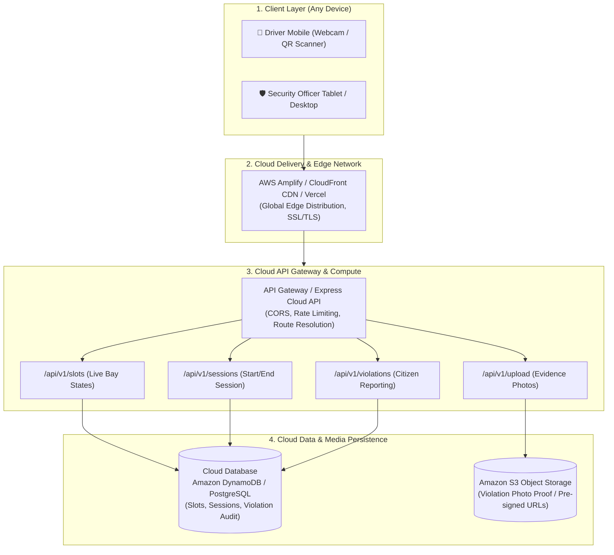

# ParkPulse – Cloud Integration & Deployment Guide
> **Comprehensive Manual for S5 Minor Project: Cloud Architecture, Real Backend Deployment, and Academic Viva Preparation**

---

## 1. Cloud Architecture Overview

ParkPulse is architected as a **decoupled, cloud-native smart parking platform**. The user interface runs as an independent Single Page Application (SPA), communicating with a cloud backend via secure REST APIs.



---

## 2. How the Frontend Connects to the Cloud

Your project features a **Dual-Mode API Layer** located in [`src/services/api.js`](file:///e:/VU%20college%20stuff/S5/major%20and%20minor%20projects/ParkPulse/src/services/api.js):

```javascript
// Reads from Vite environment variable
const API_BASE_URL = import.meta.env.VITE_API_BASE_URL || '';
```

- **Mode 1: Offline / Evaluation Fallback** (`VITE_API_BASE_URL` is empty)
  All slot reservations, QR scans, and violation logs are safely stored in browser `localStorage`. No internet connection or cloud server is required to demo the prototype.
- **Mode 2: Live Cloud Mode** (`VITE_API_BASE_URL` is set)
  The frontend automatically dispatches HTTP `fetch()` requests across the internet to your cloud backend (e.g., `https://parkpulse-api.onrender.com` or AWS API Gateway). If the cloud experiences high latency or downtime, the app gracefully falls back to local state without crashing.

---

## 3. Option A: Fast & Free Cloud Deployment (Ready in 10 Minutes)

You now have a ready-to-run backend server inside the [`server/`](file:///e:/VU%20college%20stuff/S5/major%20and%20minor%20projects/ParkPulse/server) directory. Follow these 3 steps to get a live, working URL for your college presentation:

### Step 1: Deploy Backend to Render (Free Cloud API)
1. Push your project to GitHub (or push just the `server` folder).
2. Go to [Render.com](https://render.com) and create a free account.
3. Click **New +** -> **Web Service**.
4. Connect your GitHub repository.
5. Set:
   - **Root Directory**: `server`
   - **Build Command**: `npm install`
   - **Start Command**: `node server.js`
6. Click **Deploy**. Render will generate a free HTTPS URL like:
   `https://parkpulse-api.onrender.com`
7. Test it by opening `https://parkpulse-api.onrender.com/api/v1/health` in your browser.

---

### Step 2: Deploy Frontend to Vercel (Free Global CDN)
1. Go to [Vercel.com](https://vercel.com) and log in with GitHub.
2. Click **Add New...** -> **Project**.
3. Select your `ParkPulse` repository.
4. In **Environment Variables**, add:
   - **Key**: `VITE_API_BASE_URL`
   - **Value**: `https://parkpulse-api.onrender.com` (your backend URL from Step 1)
5. Click **Deploy**. In under 60 seconds, you get a live production URL:
   `https://parkpulse.vercel.app`

---

### Step 3: Run Both Locally for Development
You can also run both simultaneously on your laptop:

```bash
# Terminal 1: Start Cloud REST Backend (Port 5000)
node server/server.js

# Terminal 2: Start React Frontend (Port 5173)
npm run dev
```

In your root `.env` file:
```env
VITE_API_BASE_URL=http://localhost:5000
```

---

## 4. Option B: AWS Enterprise Cloud Architecture (For S5 Project Report & PPT)

If your external examiner or professor asks for the **official AWS Cloud Blueprint**, describe this architecture:

### 1. Cloud Hosting: AWS Amplify & Amazon CloudFront
- **Role**: Hosts the React 19 Single Page Application.
- **Features**: Global edge caching via CloudFront CDN, automatic SSL/TLS certificate, and instant Git continuous deployment.

### 2. API & Routing: Amazon API Gateway (HTTP API)
- **Role**: Entry point for all incoming API traffic from drivers and officers.
- **Configuration**:
  - Route: `GET /api/v1/slots` -> triggers `ListSlotsLambda`
  - Route: `POST /api/v1/sessions/start` -> triggers `StartSessionLambda`
  - Route: `POST /api/v1/violations` -> triggers `ReportViolationLambda`
  - CORS headers enabled for the frontend domain.

### 3. Serverless Compute: AWS Lambda (Node.js 20)
- **Role**: Executes business logic on demand with zero server maintenance.
- **Sample AWS Lambda Handler (`StartSessionHandler.js`)**:
```javascript
import { DynamoDBClient } from "@aws-sdk/client-dynamodb";
import { DynamoDBDocumentClient, UpdateCommand, PutCommand } from "@aws-sdk/lib-dynamodb";

const ddb = DynamoDBDocumentClient.from(new DynamoDBClient({}));

export const handler = async (event) => {
  const { slotCode, vehicleNumber, driverName, zone } = JSON.parse(event.body);
  const sessionId = `sess_${Date.now()}`;
  const startTime = new Date().toISOString();

  // 1. Transactionally lock slot status in DynamoDB (Prevents Race Conditions)
  await ddb.send(new UpdateCommand({
    TableName: "ParkPulse_Slots",
    Key: { code: slotCode },
    UpdateExpression: "SET #st = :occ, occupiedBy = :occBy",
    ConditionExpression: "#st = :avail", // Atomic lock: Only updates if slot is still available!
    ExpressionAttributeNames: { "#st": "status" },
    ExpressionAttributeValues: {
      ":occ": "occupied",
      ":avail": "available",
      ":occBy": { vehicleNumber, driverName, startTime }
    }
  }));

  // 2. Insert into Sessions Table
  const sessionRecord = { sessionId, slotCode, vehicleNumber, driverName, zone, startTime, status: 'active' };
  await ddb.send(new PutCommand({
    TableName: "ParkPulse_Sessions",
    Item: sessionRecord
  }));

  return {
    statusCode: 201,
    headers: { "Access-Control-Allow-Origin": "*" },
    body: JSON.stringify(sessionRecord)
  };
};
```

### 4. Database Layer: Amazon DynamoDB (NoSQL)
- **Why DynamoDB?** Sub-10 millisecond latency for slot state checks and high concurrent write throughput when hundreds of students scan QR codes at peak campus arrival times.
- **Table 1: `ParkPulse_Slots`**
  - Partition Key (PK): `code` (e.g., `P001`, `P002`)
  - Attributes: `zone`, `level`, `type`, `status` (`available` | `occupied`), `occupiedBy`
- **Table 2: `ParkPulse_Sessions`**
  - Partition Key (PK): `sessionId`
  - Sort Key (SK): `startTime`
  - Attributes: `slotCode`, `vehicleNumber`, `driverName`, `status` (`active` | `completed`)
- **Table 3: `ParkPulse_Violations`**
  - Partition Key (PK): `id` (e.g., `VIO-2026-1024`)
  - Attributes: `category`, `vehicleNumber`, `zone`, `slotId`, `imageUrl`, `status`, `urgency`

### 5. Media Evidence Storage: Amazon S3 (Simple Storage Service)
- **Bucket**: `s3://parkpulse-violation-evidence/`
- **Workflow**:
  1. Driver snaps a photo of an illegal parking violation on their phone.
  2. Mobile client requests an **S3 Pre-signed Upload URL** from API Gateway.
  3. Image uploads directly from mobile browser to S3 via HTTPS PUT (reducing load on the application server).
  4. S3 returns the permanent public or signed image URL (`https://parkpulse-violation-evidence.s3.amazonaws.com/...`), which is saved in the DynamoDB violation record.

---

## 5. REST API Specifications

| Method | Endpoint | Description | Sample Payload / Response |
| :--- | :--- | :--- | :--- |
| `GET` | `/api/v1/health` | Health check & server status | `{"status":"healthy","uptime":320}` |
| `GET` | `/api/v1/slots` | Fetch all 24 bays & current status | Returns array of bay objects |
| `GET` | `/api/v1/slots/qr/:code` | Query specific slot by QR code | `code: "P001"` -> Bay details |
| `POST` | `/api/v1/sessions/start` | Start live session via QR check-in | `{"slotCode":"P001","vehicleNumber":"KA-03-HA-8820"}` |
| `POST` | `/api/v1/sessions/end` | Checkout & release bay | `{"sessionId":"sess_173000","slotCode":"P001"}` |
| `GET` | `/api/v1/violations` | List all reported parking violations | Returns array of violation reports |
| `POST` | `/api/v1/violations` | Submit new citizen violation report | `{"category":"Blocked Parking","vehicleNumber":"DL-01-AB-1234", ...}` |
| `PATCH`| `/api/v1/violations/:id/status`| Security Officer updates adjudication | `{"status":"warning_issued","adminNotes":"Officer dispatched"}` |
| `PATCH`| `/api/v1/slots/:slotId` | Admin manual override for bay | `{"status":"maintenance"}` |

---

## 6. Viva Questions & Expected Answers

### Q1: Why did you build a Cloud-Based solution rather than a local desktop app?
> **Answer**: A campus parking ecosystem has distributed users: drivers entering at various gates on mobile devices, and campus security officers monitoring from tablets and guardhouses. A cloud backend provides a single source of truth for bay occupancy and allows instantaneous notification of violations across all campus zones.

### Q2: How does the system handle race conditions if two drivers scan the same QR code simultaneously?
> **Answer**: In our cloud architecture, we utilize atomic conditional writes (`ConditionExpression: "status = 'available'"` in DynamoDB, or transactional database locks). The first request that arrives will update the slot status to `occupied` and succeed; the second concurrent request will evaluate the condition as false and receive an HTTP 409 Conflict error with an informative message: *"This bay was just occupied by another driver."*

### Q3: Why didn't you use ultrasonic IoT sensors on every slot?
> **Answer**: While ultrasonic and magnetic IoT sensors work in controlled indoor pilots, their large-scale deployment across outdoor campus lots faces severe battery degradation, weather interference (monsoon rain/mud), and high capital maintenance costs (replacing 500+ sensors). ParkPulse uses **QR-based digital check-ins and citizen violation reporting**, which eliminates all hardware capital expenditure and relies on the smartphones drivers already carry.

### Q4: How is violation evidence securely stored?
> **Answer**: Photos taken by reporters are stored in an Amazon S3 object storage bucket with server-side encryption (SSE-S3). Rather than transferring heavy image binaries through our API servers, the frontend requests a pre-signed S3 URL with a short expiration window (5 minutes) and uploads the JPEG directly to the cloud storage bucket.

